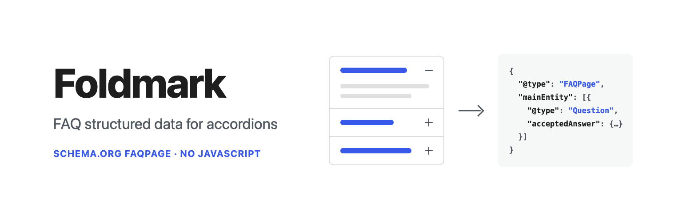
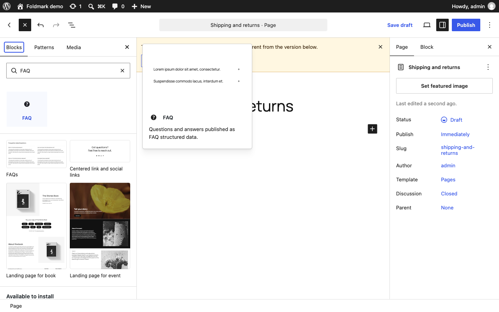
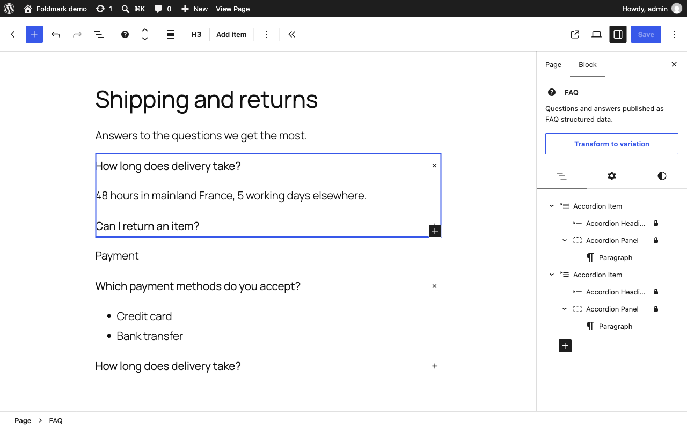
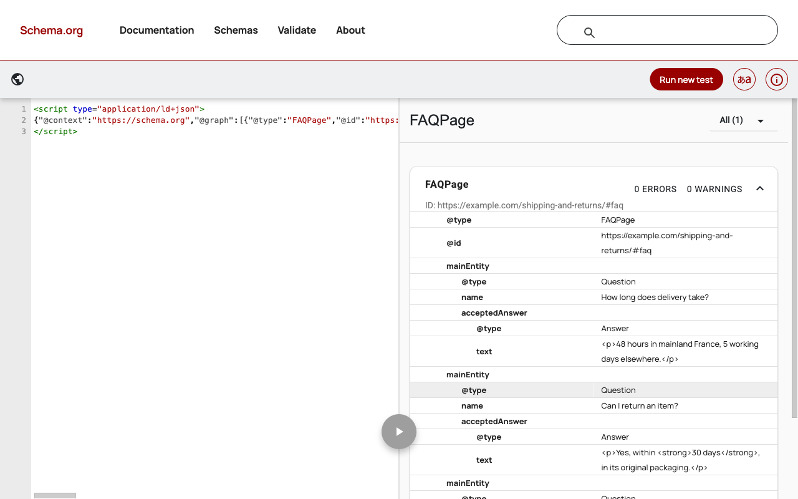

<p align="center">
  
</p>

<h1 align="center">Foldmark</h1>

<p align="center">Turn an accordion block into an FAQ with schema.org FAQPage structured data. Pure PHP, no JavaScript, nothing stored in your content.</p>

<p align="center">
  <a href="https://github.com/Fyrins/foldmark/actions/workflows/ci.yml"></a>
  <a href="LICENSE"></a>
  <a href="https://github.com/Fyrins/foldmark/issues"></a>
  <a href="https://github.com/sponsors/Fyrins"></a>
</p>

An FAQ built with the accordion block reads well for people, but machines only see headings and paragraphs. Foldmark adds an **FAQ** block to the editor (the accordion block, preset as a list of questions) and prints its questions and answers as one JSON-LD `FAQPage` in the page head. The plugin has been submitted to wordpress.org and is awaiting review.

## What it looks like

Insert the **FAQ** block from the inserter. It is the accordion block, preset with three questions.

[](.wordpress-org/screenshot-1.png)

Write each question in a heading and its answer in the panel. The sidebar shows the block as an FAQ, and **Transform to variation** turns it back into a plain accordion.

[](.wordpress-org/screenshot-2.png)

The page head gets one `FAQPage`, here checked in the Schema.org validator.

[](.wordpress-org/screenshot-3.png)

## About Google

Google stopped showing FAQ rich results in May 2026 and removed them from its testing tools in June 2026 ([announcement](https://developers.google.com/search/updates)). `FAQPage` remains a valid schema.org type that Google says it still reads to understand pages, and that other search engines and AI systems use. Foldmark publishes valid markup and makes no promise about how any engine displays it.

## Why the accordion block, and not Details

`core/details` has no container: an FAQ made of Details blocks is a set of unrelated blocks scattered through the page, and its `<summary>` is not a heading. `core/accordion`, added in WordPress 6.9, has the shape of an FAQ:

```
.wp-block-accordion                         → FAQPage
  .wp-block-accordion-item                  → Question
    .wp-block-accordion-heading__toggle-title → name
    .wp-block-accordion-panel               → acceptedAnswer.text
```

## Why JSON-LD and not microdata

Microdata needs an element for `Answer.text` that is distinct from the element carrying the `Answer` item. The answer blocks are direct children of the panel, which uses flow layout. Adding a wrapper would change the block DOM and break the `:first-child` and `:last-child` spacing rules of the layout. JSON-LD leaves the accordion markup exactly as core renders it.

## No JavaScript, even in the editor

The `foldmark` attribute and both variations are declared on the server, with the `register_block_type_args` and `get_block_type_variations` filters. WordPress already sends server-side block definitions to the editor, so the FAQ block reaches the inserter without a single line of JavaScript.

| Variation | Scope | Attribute |
|---|---|---|
| `foldmark/faq` | inserter, transform | `{"foldmark":{"type":"faq"}}` |
| `foldmark/accordion` | transform | `{"foldmark":null}` |

The attribute is an object so that other schema types can be added with another variation, another `type` value and a class registered with the `foldmark_types` filter, without touching the walker or the graph.

## Nothing is written into your content

The attribute has no `source`: it lives in the block comment, which block validation ignores. No class or wrapper is added, at save or at render. Deactivating the plugin leaves valid accordions behind; only the script disappears.

## How the graph is built

1. On a singular view, the post content is checked for an accordion or a synced pattern. Without either, nothing is parsed. Otherwise it is parsed with `parse_blocks()`, before `wp_head`, and nothing is rendered twice.
2. `Foldmark_Block_Walker` walks the tree the way core renders it: blocks hidden with the visibility control are skipped, synced patterns are followed only when published and not password protected, cycles are stopped, and expansions are capped at 100 per post with each pattern parsed once.
3. Accordions are grouped by the `type` of their `foldmark` attribute and handed to the matching `Foldmark_Type`. The FAQ type reads the plain text of each heading title, without the toggle icon, and the saved HTML of each panel, filtered with `wp_kses()` down to the tags Google accepts in `Answer.text`.
4. Empty questions and answers are dropped, duplicate questions are published once, and all FAQ blocks of the page are merged into one `FAQPage`.
5. The script is printed with `wp_print_inline_script_tag()`, encoded with `JSON_HEX_TAG` so no answer can close the script element.

Nothing is printed on archives, feeds, REST responses, password-protected posts, or pages that already contain the FAQ block of Yoast SEO, Rank Math, SEOPress or All in One SEO.

```
includes/
  class-foldmark-schema.php        names shared by everything below
  class-foldmark-editor.php        attribute and variations
  class-foldmark-block-walker.php  core rendering rules, once
  interface-foldmark-type.php      contract of a schema type
  class-foldmark-type-faq.php      the FAQ type
  class-foldmark-graph.php         dispatch from attribute type to schema type
  class-foldmark-plugin.php        per-request cache and output
  functions.php                    public API
```

## Filters and functions

```php
// Hand the FAQ to another plugin's graph instead of printing it.
// Computed once per request: add your filters before the first call.
add_filter( 'foldmark_output_enabled', '__return_false' );
$nodes = foldmark_get_graph(); // Available before wp_head.

// Change or empty the nodes. Question names are plain text: escape them as HTML.
add_filter(
	'foldmark_graph',
	function ( array $nodes, WP_Post $post ) {
		return $nodes;
	},
	10,
	2
);

// Keep more markup in answers (wp_kses() format).
add_filter(
	'foldmark_answer_allowed_html',
	function ( array $allowed, WP_Post $post ) {
		$allowed['code'] = array();
		return $allowed;
	},
	10,
	2
);

// Turn the FAQ output off when another FAQ block is on the page.
add_filter(
	'foldmark_conflicting_blocks',
	function ( array $names, WP_Post $post, string $type ) {
		$names[] = 'acme/faq';
		return $names;
	},
	10,
	3
);

// Publish another schema type from accordions marked {"foldmark":{"type":"acme"}}.
add_filter(
	'foldmark_types',
	function ( array $types ) {
		$types['acme'] = new My_Acme_Type(); // Implements Foldmark_Type.
		return $types;
	}
);
```

## Development

```bash
composer install
composer test      # PHPUnit against a real WordPress, see CONTRIBUTING.md
composer lint      # PHPCS, WordPress Coding Standards
```

See [CONTRIBUTING.md](CONTRIBUTING.md).

## License

GPL-2.0-or-later. See [LICENSE](LICENSE).
